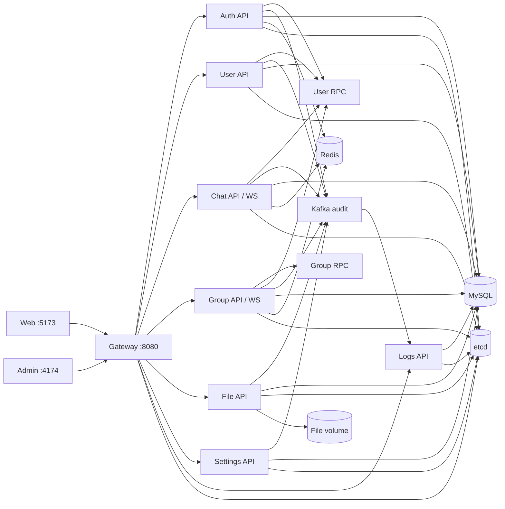

# GIM

GIM 是一个面向后端工程能力展示的即时通信系统。项目以 Go 微服务为核心，提供用户 Web、独立 Admin、私聊/群聊 WebSocket、文件服务、结构化审计链路，以及可复现的 Docker Compose、性能、稳定性和 race 验证。

当前状态：**GIM V1 = COMPLETED**。实际边界和限制见本文末尾，项目不把尚未实现的能力包装成已完成特性。

## Features

- 注册、登录、注销、JWT 鉴权、用户资料与用户配置。
- 私聊文本消息：独立 Chat WebSocket、持久化 ACK、`clientMsgId` 幂等、历史、会话、未读/已读、置顶、隐藏、撤回和在线 Presence。
- 群聊文本消息：群/成员/申请/权限、独立 Group WebSocket、持久化 ACK、幂等、历史、会话、未读/已读、置顶、隐藏、撤回和禁言。
- 文件：流式上传、50 MiB 限制、SHA-256 内容寻址去重、分页列表、鉴权下载和所有权删除。
- Admin：真实 Users / Chats / Groups / Files / Settings / Logs 管理接口与独立 Vue 应用；没有虚构 Mock 数据服务。
- Audit：业务服务生成请求隔离的结构化安全事件，经有界 Kafka producer 和 Logs consumer 幂等落库，供 Admin 查询。
- 工程化：001–008 SQL migration、服务发现、健康检查、Compose 全栈、负载工具、5 分钟稳定性基线、Linux race 验证和 CI workflow。

## Architecture



V1 保留 `Gateway -> Auth Service -> Business Service` 鉴权链。Gateway 删除客户端伪造的 `User-ID`、`Role`、`ValidPath`，再写入 Auth 的权威结果；Admin 目标服务仍执行角色二次校验。私聊和群聊使用两条连接及各自的 Hub/Client，Chat 连接独占全局 Presence 维护权。

更完整的说明见 [系统总览](docs/architecture/overview.md)、[可靠性设计](docs/architecture/reliability.md)、[文件与审计](docs/architecture/file-and-audit.md) 和 [架构决策](docs/architecture/decisions.md)。

## Tech Stack

- Backend：Go 1.25、go-zero、GORM、MySQL 8.4、Redis 7.4、etcd、gRPC、Gorilla WebSocket、JWT。
- Audit：Kafka 4.2 KRaft、`kafka-go`、MySQL `audit_logs`。
- Frontend：Vue 3、TypeScript、Pinia、Vue Router、Axios、Vite；Web 使用 Element Plus，Admin 使用 Arco Design 和 ECharts。
- Delivery：Docker Compose、多阶段镜像、非特权 Nginx、GitHub Actions workflow。

## Reliability Design

- ACK 只在事务成功后返回，表示服务端已接受并持久化，不代表接收端已送达。
- `(sender_id, client_msg_id)` 唯一约束和 duplicate-key 读取保证发送重试幂等。
- 会话表在同一事务内维护最后消息、未读与隐藏恢复；读游标采用单调更新。
- 每个 WebSocket Client 使用 `readPump + writePump` 和有界 send queue；业务代码不直接并发写连接。
- Hub 负责并发注册、注销和广播；慢消费者被有界处理，心跳和断线清理可回收连接。
- Chat Presence 使用 Redis TTL、周期刷新与最后连接删除；Group Socket 不改全局在线状态。
- MySQL 1213 只在安全事务边界内最多重试 3 次，并以 10/20 ms、可取消退避重建事务。
- Audit 有界、超时、best-effort，不阻塞核心业务；消费者以 `eventId` 唯一键幂等落库。

## Security Design

- 密码使用 bcrypt；JWT Secret 只来自未跟踪的运行环境，模板不含可用秘密。
- Gateway 统一鉴权并覆盖身份头；WebSocket token 在升级前由同一 Auth 链验证。
- Admin 前端路由不是安全边界，Users / Chat / Group / File / Settings / Logs 均在服务端校验管理员角色。
- 文件上传使用 `MaxBytesReader` 和流式哈希/写盘；服务端探测 MIME，路径经归一化并限制在存储根内；响应不泄露物理路径。
- Audit 不记录密码、JWT、Authorization、Cookie、消息正文、文件内容、DSN 或存储绝对路径；Admin 不使用 `v-html`。
- `reference/`、本地 env、证书、依赖、构建物、上传和基础设施数据均由 Git ignore/安全脚本保护。

## Performance

以下为单机开发环境可复现基线，不是容量承诺：

- 最大已测：200 个并发 Private WebSocket 连接。
- 100 连接、50 msg/s、20 秒：1000/1000 ACK，2600/2600 delivery，ACK p95 13.47 ms。
- 修复后 5 分钟 soak：Private 1500/1500 ACK/rows、2100/2100 delivery；Group 600/600 ACK/rows、6000/6000 delivery；无错误、重连或 drop。
- 1 MiB 文件、并发 10：60.75 MiB/s；10 MiB 文件、并发 5：211.75 MiB/s。
- Linux Docker full/focused/real-dependency race：PASS。Windows native 因 32-bit MinGW 不兼容而不可用。

完整环境、方法和结果见 [性能基线](docs/performance/baseline.md)。

## Quick Start

前置条件：Docker Desktop/Engine、Docker Compose v2，建议至少 8 GiB 可用内存。

```powershell
Copy-Item .env.compose.example .env.compose.local
# 编辑 .env.compose.local，替换全部 CHANGE_ME
docker compose up -d --build
docker compose ps
```

访问：

- Web：`http://127.0.0.1:5173`
- Admin：`http://127.0.0.1:4174`
- Gateway：`http://127.0.0.1:8080`

全新数据库不会预置管理员。按 [Compose 部署说明](docs/deployment/docker-compose.md#initial-administrator) 使用一次性 bootstrap 创建。停止环境使用 `docker compose down`；该命令保留 named volumes。

## Testing

```powershell
cd server
go test ./... -count=1
go vet ./...

cd ../web
pnpm install
pnpm type-check
pnpm test
pnpm build

cd ../admin
pnpm install
pnpm type-check
pnpm test
pnpm build
```

仓库安全检查：

```powershell
./scripts/check-repository-safety.ps1
```

Linux race、负载参数和真实依赖测试入口分别见 [race runner](scripts/run-race-docker.ps1)、[load harness](server/tools/loadtest/README.md) 与 [测试验收](docs/10_TEST_ACCEPTANCE.md)。当前稳定结果为 Web 16 files / 90 tests、Admin 11 files / 25 tests；远端 GitHub Actions 结果在本地收口时为 `NOT OBSERVED`，只声明 local equivalent PASS。

## Repository Structure

```text
server/       Go services, migrations, integrations and load harness
web/          Vue 3 user application
admin/        Independent Vue 3 administration application
docker/       Production-style multi-stage images and Nginx config
docs/         Contracts, architecture, deployment, performance and interview notes
scripts/      Repository safety, snapshots and Linux Docker race tools
agent_logs/   Phase/checkpoint evidence and operation records
reference/    Local read-only references; ignored and never part of GIM builds
```

## Known Limitations

- Chat/Group V1 只完成文本消息；图片、视频、普通文件、语音、回复/引用、@ 和图文尚未接入消息协议。
- 没有接收方 delivery receipt 或 read receipt；ACK 仅表示服务端持久化/接受。
- 前端 pending 消息不跨浏览器刷新持久化；File 尚未与 Chat/Group 消息协议集成。
- 当前用户端没有完整好友管理 HTTP/UI 流程；私聊验收使用明确、可清理的对称好友 fixture。
- 删除最后一个 File 引用不会同步删除物理对象；孤立内容寻址对象等待后续 GC。浏览器下载会把响应物化为 Blob。
- Audit 是有界 best-effort，无 transactional outbox、DLQ、磁盘 spool 或 exactly-once；长时间 Kafka 故障允许丢失审计事件。
- 高压进程重启存在“数据库已提交，但 ACK/实时推送尚未完成”的窗口；同一 `clientMsgId` 重试和历史查询可恢复，但 V1 不承诺实时 exactly-once。
- Compose 面向 single-host/single-node development；无 HA、Kubernetes、内部 TLS、生产 Secret Manager 或云部署方案。
- Admin 生产构建仍有非阻塞的 chunk-size warning；远端 CI 执行结果未从当前环境观察。

## Roadmap

V1.1 候选方向包括好友管理闭环、富消息与 File 消息引用、pending 持久化、delivery/read receipt、文件孤儿 GC、transactional outbox/DLQ、Admin chunk 拆分，以及多节点路由与生产安全基线。它们均不属于当前 V1 完成声明。

## Reference and Independence

GIM 在需求分析阶段参考了 FIM Server、用户 Web 和 Admin 的业务行为、接口语义、页面流程、数据关系与已知问题。`reference/` 始终只读且被 Git/Docker 构建排除；GIM 没有对其进行 import、运行时读取或构建依赖，也没有通过整仓复制、批量改名或机械替换生成实现。服务组织、并发模型、可靠性、安全边界、测试和部署均由 GIM 文档解释。

面试材料入口：[项目概览](docs/interview/project-overview.md)、[架构问答](docs/interview/architecture-questions.md)、[可靠性问答](docs/interview/reliability-questions.md)、[简历要点](docs/interview/resume-bullets.md)。
