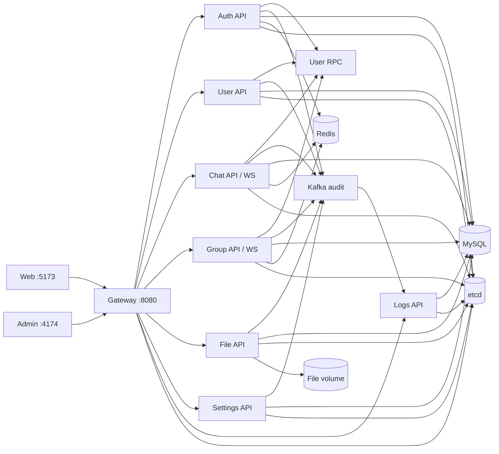

# GIM

GIM 是一个面向后端工程能力展示的即时通信系统：Go 微服务 + 用户端 Web + 独立 Admin，覆盖鉴权、好友闭环、私聊/群聊 WebSocket、可靠消息、文件流式上传、结构化审计与可复现的 Compose 拓扑。

当前状态：**V1 = COMPLETED**（文本 IM + 文件 + 好友闭环 + Admin + 审计）。基线 tag 为 `gim-v1`，本轮整理与补验证后的版本为 `gim-v1.1`；真实验证范围见 [验证状态](docs/validation-status.md)。

## V1 范围

**已实现**

- 注册、登录、注销、JWT、`Gateway → Auth → 业务服务` 鉴权链。
- 好友闭环：搜索、申请、同意/拒绝、好友列表（Redis Presence `isOnline`）、方向性备注、删除、好友详情，以及用户端 `/contacts` 页面。
- 私聊/群聊文本消息：两条 WebSocket、Hub/Client + `readPump/writePump`、心跳、断线清理、`clientMsgId` 幂等、事务后 ACK、历史、最近会话、置顶、未读/已读、用户维度隐藏。
- 文件：流式上传、50 MiB 限制、SHA-256 内容寻址去重、`FileObject/UserFile` 所有权、鉴权下载、引用删除。
- Admin：独立 Vue 应用，真实 Users/Chats/Groups/Files/Settings/Logs 接口，服务端 `Role == 1` 二次校验，真实聚合概览。
- Kafka 结构化审计：共享 bounded producer、每请求独立事件、字段 allowlist/脱敏、consumer `event_id` 幂等落库、Admin 查询。
- 工程化：001–008 migration、17 个 Compose service、单测、前端类型检查/测试/构建、仓库安全脚本。

**V2 Phase 1（已实现）**

- 图片消息 `type=2`：先 `POST /api/file/image` 上传，再通过 `chat.send` / `group.send` 发送 `imageMsg.fileID`；服务端校验文件归属、`image/*` MIME 与大小后，在同一事务落库并 ACK/推送，历史 DTO 与 WS 同构；Web 支持选择图片、上传、发送、渲染与点击预览。
- 普通文件消息 `type=3`：先 `POST /api/file/file` 上传，再发送 `fileMsg.fileID`；服务端校验归属与 `FILE_MESSAGE_MAX_BYTES`（默认 25 MiB，不限制 MIME 前缀），回填 `fileName/size/mimeType`；Web 支持选择文件、上传、发送、文件卡片与鉴权下载。
- 撤回消息 `type=4`：`withdrawMsg.msgID` 指向原消息，沿用 `chat.send`/`group.send`；服务端校验目标存在/本人/未 tombstone/未撤回/`RECALL_WINDOW_SECONDS`（默认 120s）/群成员；历史返回 `[撤回]` 占位，文件下载授权对非所有者失效；Web 支持窗口内撤回与本地占位替换。
- 好友上线提醒：Chat Hub 本地 0→1/1→0 → 有界异步 worker 查询好友 → `friend.online`/`friend.offline`；仅通知好友、过滤自己/已删除/封禁；Web Chat WS 实时更新 `isOnline`，HTTP 好友列表仍是权威恢复路径。多实例全局 Presence 判断为 V2。

**未实现（V2，不得声称完成）**

- 富消息：视频文件、语音、回复/引用、@、图文（**图片、普通文件与撤回已在 V2 Phase 1 实现**）。
- 管理员撤回（含原因/审计）尚未设计，留待 V2 后续。
- 多实例好友上线提醒（全局 0→1/1→0）、好友申请实时推送、好友申请方向的完整历史列表。
- `user_confs` 读写、`PUT /api/user/user_info`、`DELETE /api/chat/chat`、`POST /api/user/valid`、`POST /api/auth/open_login`。
- 接收方 delivery/read receipt、WS 一次性 Ticket、Gateway 本地验签、多实例 WS 路由。
- HA/Kubernetes/内部 TLS、文件孤儿 GC、审计 outbox/DLQ。

## 架构



- Gateway 删除客户端伪造的 `User-ID`/`Role`/`ValidPath`，调用 Auth 后注入可信身份；Admin 目标服务再次校验角色。
- 只有 User RPC 一个内部 gRPC 服务；Group API 直接使用 MySQL/Redis/User RPC（原 Group RPC 无调用方，已删除）。
- 私聊/群聊使用两条连接与各自 Hub/Client；只有 Chat WS 维护全局 Presence。
- 详细设计：[架构总览](docs/01_PROJECT_ARCHITECTURE.md)、[后端](docs/02_BACKEND_DESIGN.md)、[可靠性](docs/architecture/reliability.md)、[文件与审计](docs/architecture/file-and-audit.md)。

## 技术栈

- **后端**：Go 1.25、go-zero、GORM、MySQL 8.4、Redis 7.4、etcd、gRPC、Gorilla WebSocket、JWT。
- **审计**：Kafka 4.2 KRaft、`kafka-go`、MySQL `audit_logs`。
- **前端**：Vue 3、TypeScript、Pinia、Vue Router、Axios、Vite；Web 使用 Element Plus，Admin 使用 Arco Design + ECharts。
- **交付**：Docker Compose、多阶段镜像、非特权 Nginx、GitHub Actions workflow。

## 目录结构

```text
server/       Go 服务、migrations、集成测试、负载工具
web/          Vue 3 用户端
admin/        独立 Vue 3 管理端
docker/       多阶段镜像与 Nginx 配置
docs/         契约、架构、部署、验证、面试材料
scripts/      仓库安全、性能快照、Linux race runner
agent_logs/   逐操作记录与每日汇总
reference/    只读参考源码（Git ignored，不参与构建）
compose.yaml  单机全栈拓扑
```

## 环境要求

- Go 1.25.x（后端构建/测试）。
- Node.js 24.x + pnpm 11.x（前端）。
- Docker Desktop/Engine + Compose v2（推荐，单机全栈）。
- 若不用 Docker：MySQL 8.x、Redis 7.x、etcd 3.x；Kafka 可选（仅审计）。
- 建议至少 8 GiB 可用内存。

## 快速启动（Compose）

```powershell
Copy-Item .env.compose.example .env.compose.local
# 编辑 .env.compose.local，替换全部 CHANGE_ME；JWT Secret 用密码学随机值
docker compose up -d --build
docker compose ps
```

入口：

- Web：`http://127.0.0.1:5173`
- Admin：`http://127.0.0.1:4174`
- Gateway：`http://127.0.0.1:8080`

全新数据库不预置管理员，按 [Compose 部署说明](docs/deployment/docker-compose.md#initial-administrator) 使用一次性 bootstrap 创建。`docker compose down` 保留 named volumes；`down -v` 会删除本项目开发数据。

## 本地原生启动

```powershell
# 1) 配置（根目录，已被 Git 忽略）
Copy-Item .env.example .env.local
# 编辑 .env.local：MySQL/Redis/etcd 地址、JWT_SECRET（>=32 字节）、各端口

# 2) 迁移（在 server/ 下）
cd server
go run ./cmd/migrate -env ..\.env.local -command up
go run ./cmd/migrate -env ..\.env.local -command status

# 3) 按顺序启动（每个命令一个终端）
$env:GIM_ENV_FILE = '..\.env.local'
go run ./cmd/user-rpc
go run ./cmd/user-api
go run ./cmd/auth-api
go run ./cmd/chat-api
go run ./cmd/group-api
go run ./cmd/file-api
go run ./cmd/settings-api
go run ./cmd/logs-api
go run ./cmd/gateway
```

依赖：`user-rpc` 必须先于 `user-api`/`auth-api`/`chat-api`/`group-api`；Kafka 未配置时审计 producer/consumer 自动禁用，核心 IM 仍可启动。migration 支持 `up` / `down -steps N` / `status`。

## 前端启动

```powershell
cd web
Copy-Item .env.example .env.local   # VITE_API_BASE_URL=/ 与 VITE_DEV_GATEWAY_TARGET
pnpm install
pnpm dev

cd ..\admin
Copy-Item .env.example .env.local
pnpm install
pnpm dev
```

生产构建使用 `pnpm build`；Web/Admin 均通过同源 `/api` 访问 Gateway（含 WebSocket Upgrade）。

## 默认配置

- 仓库只提交 `.env.example` / `.env.compose.example`，全部为 `CHANGE_ME` 占位。
- 运行值写入被忽略的 `.env.local` / `.env.compose.local`。
- Settings 数据库只保存公开业务配置（站点名/版本/公告/注册开关/开放登录开关），不保存 JWT、DSN、OAuth Secret 等部署秘密。

## 测试

```powershell
# 后端
cd server
go build ./...
go vet ./...
gofmt -l .
go test ./... -count=1

# 真实依赖集成测试（需要 MySQL/Redis/etcd；Kafka 用例需额外开关）
$env:GIM_ENV_FILE = '<absolute path to env file>'
go test ./tests -count=1 -v

# Linux race（Windows native 因工具链限制不可用）
go test -race ./... -count=1

# 前端
cd ..\web
pnpm type-check; pnpm test; pnpm build

cd ..\admin
pnpm type-check; pnpm test; pnpm build

# 仓库安全
./scripts/check-repository-safety.ps1
```

## 验证状态

最近一次真实验证（2026-11-14，见 [验证状态](docs/validation-status.md)）：

- **race**：Linux Docker `go test -race ./... -count=1` **PASS**（`golang:1.25-bookworm`，挂载 module cache，`GOPROXY=off`；无 race warning）。
- **Compose 全栈**：`docker compose up -d --build` **PASS**；17 services = 15 running healthy + `migration`/`storage-init` exit 0。
- **Kafka 真实消费**：`GIM_KAFKA_INTEGRATION=1`（Compose broker）**2 个用例 PASS**。
- **浏览器好友 E2E**：Chrome + Compose Web，注册→搜索→申请→同意→备注→删除 **11 步 PASS**。
- **图片消息（V2 Phase 1）**：后端图片单测 + 聊天图片真实 MySQL/Redis/WS 集成 **PASS**（ACK、接收、历史、重复 clientMsgId 仅 1 行、归属/MIME/大小错误码、接收方下载授权）；浏览器私聊图片 E2E **10 步 PASS**；Web `vue-tsc` + **21 files / 114 tests** + build PASS。
- **图片 Phase 1 收尾（2026-11-14）**：图片代码 Linux Docker race **PASS**（无 race warning）；文件下载授权专项测试 **PASS**（所有者/私聊接收方/群成员/非参与者 `2503`/tombstone/退群/未知 fileID/文本不授权）；群聊图片 E2E **PASS**（B/C 收到并预览，非成员 D `2503`，B 退群后 `2503`，owner 仍可下载）。
- **普通文件消息（V2 Phase 1，2026-11-14）**：后端单测 + 聊天文件真实 MySQL/Redis/WS 集成 **PASS**（`type=3` ACK、接收、历史、重复 clientMsgId 仅 1 行、`2215/2216` 不落库、接收方可下载）；Web `vue-tsc` + **21 files / 122 tests** + build PASS；浏览器 E2E **PASS**（A 发送 `report.pdf` → B 收到并下载 → 非参与者 D `2503`）。
- **文件 Phase 收尾（2026-11-14）**：全量 Linux Docker race **PASS**（无 race warning）；群聊文件 E2E **PASS**（B/C 收到并下载、非成员 D `2503`、B 退群后 `2503`、owner 仍可下载）。
- **撤回消息（2026-11-14）**：后端单测 + 真实 MySQL/Redis/WS 集成 **PASS**（ACK、接收、历史占位、重复撤回、窗口/非本人/tombstone、文件下载撤销）；Web `vue-tsc` + **21 files / 131 tests** + build PASS；浏览器 E2E **PASS**（文本+文件撤回、占位、接收方下载 `2503`、owner 仍 200）。
- **撤回收尾（2026-11-14）**：并发撤回测试 **PASS**（观察到 1 条，K-14 记录边界）；短窗口 E2E **PASS**（3s 内成功、4s 后 `2220`）；撤回代码全量 Linux Docker race **PASS**（无 race warning）。
- **好友上线提醒（2026-11-14）**：后端单测 + 真实 MySQL/Redis/WS 集成 **PASS**（online/offline、多端只一次、非好友不通知）；Web `vue-tsc` + **21 files / 135 tests** + build PASS；浏览器 E2E **PASS**（A 登录→B 在线、A 关闭→B 离线、A 重登→B 在线）。
- **性能最小场景**：HTTP profile c10/10s 27281/27281、2728 req/s、p95 4.834 ms；Private 10 conn/10s@10 msg/s 100/100 ACK、100/100 delivery、p95 22.859 ms、correctness PASS。
- 既有验证（2026-11-11）：后端单测 **69 包 PASS**；真实依赖集成 **20 PASS / 1 SKIP / 0 FAIL**（该 SKIP 的 Kafka 用例已由第五轮补齐）；Web 当时 **19 files / 103 tests** + build PASS；Admin **11 files / 25 tests** + build PASS；`docker compose config` PASS；仓库安全脚本 PASS。
- **仍未验证**：完整性能阶梯（25/50/100/200 连接、50 msg/s）、5 分钟 soak、restart 稳定性、文件吞吐档位、图片/文件消息吞吐与预览性能；远端 CI 结果为 `NOT OBSERVED`。

## Tag

- `gim-v1`：2026-10-15 的 V1 基线（历史 checkpoint，不移动、不删除）。
- `gim-v1.1`：项目整理 + 补验证 + 验证状态更新（C1/C2、好友闭环、race/Compose/Kafka/浏览器 E2E）。
- `gim-v1.2`：图片消息、普通文件消息、文件授权专项与文件 Phase 收尾。
- `gim-v1.3`：撤回消息实现 + 撤回收尾（并发/短窗口/race）+ 好友上线提醒协议设计。
- `gim-v1.4`：好友上线提醒单机实现 + 前后端测试/集成/E2E/race；多实例 Presence、user_confs、管理员撤回仍未实现。

## 已知限制

- 图片、普通文件、撤回与好友上线提醒已支持（`type=2/3/4` + `friend.online/offline`，单机）；管理员撤回、多实例 Presence、语音/视频/回复/引用/@/图文仍为 V2。
- 无接收方 delivery/read receipt；ACK 只表示服务端已持久化/接受。
- 好友 `isOnline` 在页面加载时读取，不是实时推送；申请列表只提供接收方向。
- pending 消息不跨浏览器刷新持久化；File 尚未与消息协议集成。
- Audit 为 bounded best-effort，无 outbox/DLQ/exactly-once；文件无孤儿 GC。
- 高压重启存在“DB 已提交、ACK/实时推送未完成”的窗口，可用 `clientMsgId` 重试与 history 恢复。
- Compose 面向单机开发，无 HA/Kubernetes/内部 TLS/Secret Manager。
- Admin 生产构建有非阻塞的 chunk-size warning；远端 CI 结果在本环境为 `NOT OBSERVED`。

## GitHub 安全

- `reference/` 被 `.gitignore` 与 `.dockerignore` 排除，从未进入 Git 历史，也不参与构建。
- `.env*`、证书/私钥、`node_modules/`、构建产物、上传与本地基础设施目录均被忽略。
- 仓库历史扫描确认无 `.key`/`.pem`/`reference/` 被加入；HEAD 无密钥标记；`scripts/check-repository-safety.ps1` PASS。
- 部署秘密只来自运行环境，不写入仓库、Settings 表或日志。

## 文档入口

- [HTTP API](docs/05_HTTP_API.md)、[WebSocket 协议](docs/06_WEBSOCKET_PROTOCOL.md)、[核心流程](docs/07_CORE_FLOWS.md)
- [数据库设计](docs/04_DATABASE_DESIGN.md)、[Redis/配置](docs/08_REDIS_CONFIG.md)
- [验证状态](docs/validation-status.md)、[测试验收](docs/10_TEST_ACCEPTANCE.md)、[已知问题](docs/known-issues.md)
- [Compose 部署](docs/deployment/docker-compose.md)、[性能基线](docs/performance/baseline.md)
- [面试材料](docs/interview/project-overview.md)
